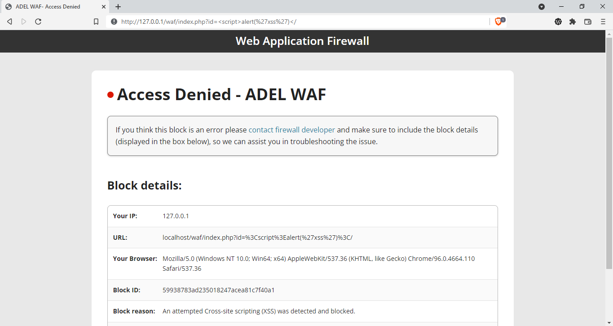

# ADEL-WAF
Firewall de aplicaciones web ligero e integrado para PHP.



Características / Protecciones contra:
- Scripting entre sitios (XSS)
- Inyección SQL (SQLI)
- Inclusión remota de archivos (RFI)
- Ejecución remota de código (RCE)
- Inclusión local de archivos (LFI)
- Denegación de servicio (DOS)
- Web shells

Cómo usarlo:

Editar archivo php.ini:
```
auto_prepend_file = "/path/to/AdelWAF.php" 
```
--------------------------------OR--------------------------------

Editar archivo .htaccess (solo si no es posible editar php.ini)
```
<IfModule php7_module> php_value auto_prepend_file "/path/to/AdelWAF.php" </IfModule> <IfModule lsapi_module> php_value auto_prepend_file "/path/to/AdelWAF.php" </IfModule> 
```
--------------------------------OR--------------------------------

Incluye este archivo PHP en cada página que desees proteger.

Nota: Funciona con todos los frameworks de PHP (Úsalo como filtro)
